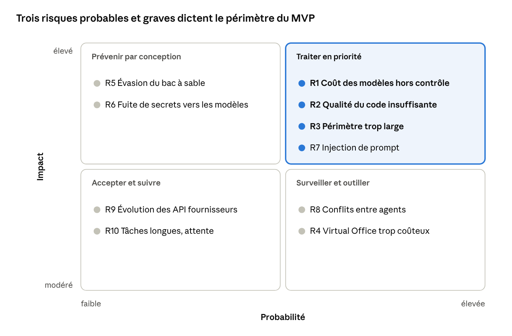

# AI Engineering Workspace — Product Discovery

8 novembre 2026 · Décisions D1 à D12 validées le 8 novembre 2026. Périmètre ensuite élargi au produit complet (voir `02-architecture.md`, plan de livraison).

## Compréhension du produit

Le produit est une entreprise d'ingénierie logicielle virtuelle : le développeur, en position de CTO, recrute et dirige des agents IA qui livrent un vrai logiciel (code dans Git, tests exécutés, rapports de sécurité, documentation).

**Proposition de valeur.** Passer de « je code avec une IA » à « je dirige une équipe d'IA ». Le développeur délègue un cahier des charges entier et garde le contrôle sur les décisions importantes.

**Ce que le produit n'est pas :**

- Un éditeur de code augmenté par l'IA.
- Une interface de chat avec plusieurs agents.
- Une simulation graphique décorative.

**Trois piliers d'égale importance :**

1. **Entreprise virtuelle** : bureau graphique, départements, agents avec identité, états visibles, salles de réunion.
2. **Orchestration multi-agents** : moteur d'exécution avec états persistants, événements, dépendances, mémoire partagée et individuelle, reprise sur échec.
3. **Production logicielle réelle** : dépôts Git, branches, exécution isolée, tests, revues, validation objective.

**Le principe qui les relie : un seul flux d'événements.** L'orchestrateur émet chaque fait réel (tâche démarrée, fichier modifié, test échoué, réunion ouverte). Le Virtual Office, le Kanban et le dashboard ne sont que des vues sur ce flux. C'est ce qui garantit l'absence de simulation trompeuse.

**Deux modes de pilotage, cumulables :** Mode A, le Lead IA analyse, recrute, délègue et contrôle ; Mode B, le développeur fait tout à la main. Toute décision du Lead peut être reprise par l'humain.

## Personas

Le persona prioritaire est le développeur freelance ou fondateur technique solo : il a le plus à gagner à disposer d'une équipe, et le moins de contraintes d'organisation.

| Persona | Contexte | Objectif principal | Frustration actuelle | Mode privilégié |
| --- | --- | --- | --- | --- |
| Fondateur technique solo / freelance | Seul face à des projets complets (backend, frontend, tests, déploiement) | Livrer un produit complet sans recruter | Les assistants IA aident ligne par ligne, pas projet par projet | A, avec reprise en main ponctuelle |
| Tech Lead / CTO de PME | Petite équipe humaine, backlog qui déborde | Déléguer des modules entiers et garder la qualité | Pas de traçabilité ni de contrôle sur le code généré par l'IA | B, décisions d'architecture gardées |
| Architecte / consultant | Cadrage et prototypage pour des clients | Produire vite une architecture et un POC argumentés | Le prototypage prend des semaines | A pour le POC, B pour l'architecture |
| Responsable sécurité / conformité (secondaire) | Doit approuver ce qui part en production | Auditer qui a fait quoi, avec quelles permissions | Les agents IA sont des boîtes noires | Consultation, validations |

Le dernier persona n'utilise pas le produit au quotidien, mais ses exigences (journal d'audit, validations humaines, permissions) doivent être dans l'architecture dès le départ.

## Cas d'utilisation

Le parcours de référence est UC-1 : du cahier des charges à un premier livrable validé, de bout en bout avec de vrais agents et un vrai dépôt.

**UC-1 — Projet piloté par le Lead (Mode A) :**

1. Le développeur crée un projet et importe son cahier des charges (texte ou fichier).
2. Le Lead analyse la demande, pose ses questions de clarification et attend les réponses.
3. Le Lead produit une note d'analyse : besoins fonctionnels et non fonctionnels, domaines métier, risques, architecture proposée.
4. Le Lead propose une équipe, chaque recrutement justifié par un besoin du projet.
5. Le développeur accepte, modifie ou refuse la proposition.
6. Les agents recrutés rejoignent leurs départements dans le Virtual Office.
7. Le Lead organise la réunion de lancement ; un compte rendu avec décisions et actions est produit.
8. Le Lead décompose le projet en tâches avec critères d'acceptation et dépendances, puis les affecte.
9. Chaque agent travaille sur sa branche dans un environnement isolé.
10. Un reviewer accepte ou demande des corrections ; le QA exécute les tests.
11. Le moteur de validation ne clôt la tâche que si les critères objectifs sont remplis.
12. Le développeur approuve les actions sensibles (merge sur la branche principale, déploiement).

**Autres cas d'utilisation :**

| ID | Cas d'utilisation | Acteur | Mode |
| --- | --- | --- | --- |
| UC-2 | Composer une équipe à la main depuis le catalogue de profils | Développeur | B |
| UC-3 | Créer ou modifier une tâche et l'affecter à un agent | Développeur | B |
| UC-4 | Cliquer sur un agent : profil, mission en cours, historique, livrables | Développeur | A et B |
| UC-5 | Converser directement avec un agent | Développeur | A et B |
| UC-6 | Suspendre, remplacer ou réaffecter un agent | Développeur | A et B |
| UC-7 | Annuler une décision du Lead (recrutement, affectation, choix technique) | Développeur | A |
| UC-8 | Convoquer une réunion, y participer ou lire son compte rendu | Lead ou développeur | A et B |
| UC-9 | Un agent demande une clarification, signale un blocage ou sollicite une revue | Agent | A et B |
| UC-10 | Approuver ou refuser une action sensible en attente | Développeur | A et B |
| UC-11 | Consulter le code, les diffs par agent, les logs et les résultats de tests | Développeur | A et B |
| UC-12 | Lancer un scan de sécurité et lire les vulnérabilités avec preuve et criticité | Security Engineer ou développeur | A et B |
| UC-13 | Suivre le dashboard CTO : avancement, blocages, coût des modèles | Développeur | A et B |
| UC-14 | Associer un fournisseur et un modèle IA à un poste | Développeur | A et B |

Le scénario de la plateforme bancaire en microservices (§13 du brief) sert de test d'acceptation de UC-1, à périmètre réduit (D12) : un service « comptes » et une interface minimale suffisent pour prouver la boucle complète.

## Fonctionnalités

Toutes les fonctionnalités ci-dessous font partie du produit complet. La phase indique l'ordre de construction (voir le plan de livraison dans `02-architecture.md`).

| Fonctionnalité | Incrément |
| --- | --- |
| Authentification, workspace, création de projet, import du cahier des charges | 1 |
| Fiche agent complète : identité, poste, compétences, instructions système, modèle, outils, permissions, historique | 1 |
| Abstraction fournisseurs IA (au moins deux fournisseurs branchés) + suivi des tokens et du coût | 1 |
| Flux d'événements persistant + journal d'audit | 1 |
| Dashboard CTO alimenté uniquement par des données réelles | 1 |
| Virtual Office : départements, avatars, états pilotés par les événements, salle de réunion | 2 |
| Recrutement : catalogue extensible + proposition justifiée du Lead (accepter, modifier, refuser) | 2–3 |
| Organigramme | 2 |
| Analyse du cahier des charges, questions de clarification, note d'architecture | 3 |
| Tâches (critères d'acceptation, dépendances, historique) + Kanban | 3 |
| Vue chronologique et réunions avec compte rendu (décisions, actions, responsables) | 3 |
| Messagerie inter-agents, mémoire partagée du projet et mémoire individuelle | 3 |
| Git (GitHub d'abord), une branche par tâche, merge contrôlé, détection des conflits | 4 |
| Exécution isolée en conteneur, code workspace (arborescence, diffs par agent, logs, tests), revue de code, moteur de validation, validations humaines | 4 |
| Département Security : scan statique, dépendances, secrets, tests dynamiques, rapport avec preuve et criticité | 5 |
| Tests E2E, de performance et de charge | 5 |
| GitLab, centre de déploiement, releases | 6 |
| Participation humaine en direct aux réunions | 6 |
| Plusieurs humains par workspace (rôles, partage) | 6 |

Un écran non encore implémenté reste visible dans la navigation avec l'étiquette « Non disponible », jamais rempli de données fictives.

## Contraintes

La contrainte la plus structurante est l'interdiction de toute simulation : elle impose que l'interface soit entièrement dérivée de l'état réel de l'orchestrateur.

| Domaine | Contrainte | Conséquence pour la conception |
| --- | --- | --- |
| Produit | Aucune animation ni donnée fictive présentée comme réelle | Chaque état visuel d'agent correspond à un événement persisté ; un écran sans données affiche un état vide |
| Produit | Modes A et B cumulables, l'humain garde le dernier mot | Toute décision du Lead est un objet modifiable et réversible, pas un effet de bord |
| Produit | Un agent ne déclare jamais seul une tâche terminée | La clôture passe par un moteur de validation distinct des agents |
| Technique | Indépendance vis-à-vis des fournisseurs IA | Interface commune pour les appels de modèles, outils et streaming ; modèle choisi par poste |
| Technique | Exécution réelle de code et de commandes | Conteneurs isolés par tâche, sans accès réseau par défaut |
| Technique | Agents simultanés sans écrasement silencieux | Une branche par tâche, merge uniquement après revue, verrous logiques sur les fichiers partagés |
| Technique | Reprise après panne | État des tâches et des agents persisté à chaque étape, exécutions idempotentes |
| Sécurité | Permissions granulaires, aucun accès illimité | Chaque outil appelé par un agent passe par un contrôle de permissions central |
| Sécurité | Validation humaine des actions sensibles | Une file d'approbations ; l'action reste suspendue tant qu'elle n'est pas approuvée |
| Sécurité | Secrets et clés API protégés | Coffre de secrets ; les clés n'entrent jamais dans le contexte des modèles |
| Coûts | Quotas et limites de consommation | Budget par projet et par agent, arrêt automatique au dépassement, coût visible dans le dashboard |
| UX | Produit premium et immersif, fluide, responsive (ordinateur d'abord) | Rendu du Virtual Office performant ; vues de gestion utilisables sur tablette |

## Risques

Les trois risques à traiter dès la conception sont le coût des modèles, la qualité du code produit et la taille du périmètre.

| Risque | Mesure de réduction |
| --- | --- |
| R1 Coût des modèles hors contrôle (boucles, contextes trop longs) | Budget par projet et par agent, arrêt automatique au dépassement, limite d'itérations par tâche, modèles moins chers pour les postes simples |
| R2 Qualité du code insuffisante, agents incohérents entre eux | Contrats d'API et architecture définis avant le code, revue obligatoire, validation par tests exécutés, mémoire partagée des décisions |
| R3 Périmètre trop large | Incréments ordonnés avec critère de passage, projet de démonstration réduit (D12) |
| R4 Virtual Office qui absorbe l'effort de développement | Bibliothèque d'assets 2D limitée, rendu branché sur le flux d'événements dès la première version |
| R5 Évasion du bac à sable ou commande destructrice | Conteneurs sans privilèges, réseau coupé par défaut, liste blanche de commandes, quotas CPU, mémoire et durée |
| R6 Fuite de secrets vers les modèles ou les journaux | Coffre de secrets, injection à l'exécution uniquement, masquage dans les logs, scan des secrets avant commit |
| R7 Injection de prompt via le code, les dépendances ou les documents importés | Contenus externes traités comme des données, permissions vérifiées côté serveur, validation humaine des actions sensibles |
| R8 Conflits entre agents travaillant en parallèle | Une branche par tâche, dépendances explicites, détection des conflits au merge, le Lead arbitre |
| R9 Évolution des API des fournisseurs | Couche d'abstraction avec adaptateurs par fournisseur et tests de contrat |
| R10 Tâches longues, l'utilisateur attend sans visibilité | Progression visible en temps réel, notifications à la fin ou en cas de blocage |

## Décisions (validées)

| # | Décision | Choix retenu | Raison |
| --- | --- | --- | --- |
| D1 | Mode de distribution | Auto-hébergée (Docker Compose) d'abord | Le code et les secrets restent chez l'utilisateur |
| D2 | Clés des modèles IA | Fournies par l'utilisateur | Coûts transparents, aucune facturation à gérer |
| D3 | Fournisseurs IA | Anthropic + une API compatible OpenAI | Prouve l'abstraction et couvre les modèles locaux (Ollama, vLLM) |
| D4 | Découpage du backend | Monolithe modulaire Spring Boot + workers d'exécution séparés | Modules isolés sans coût opérationnel |
| D5 | Messagerie asynchrone | Redis Streams + outbox PostgreSQL | Suffisant en auto-hébergé ; Kafka possible derrière la même interface |
| D6 | Frontend | React + TypeScript | Écosystème pour le rendu 2D et Monaco |
| D7 | Rendu du Virtual Office | 2D isométrique en WebGL (PixiJS) | Immersif et fluide, coût des visuels maîtrisé |
| D8 | Moteur d'orchestration | Moteur maison en Java, MCP pour les outils | États persistants, reprise et validation : cœur du produit |
| D9 | Hébergement Git | Dépôt local + push GitHub ; GitLab ensuite | Les agents travaillent en local |
| D10 | Autonomie par défaut du Lead | Approbation du recrutement, de l'architecture et des actions sensibles | Contrôle humain sans micro-validation |
| D11 | Langue | Interface multilingue, anglais par défaut | Code et profils en anglais |
| D12 | Projet de démonstration | Un service « comptes » + une interface minimale | Prouve la boucle complète à coût modéré |
