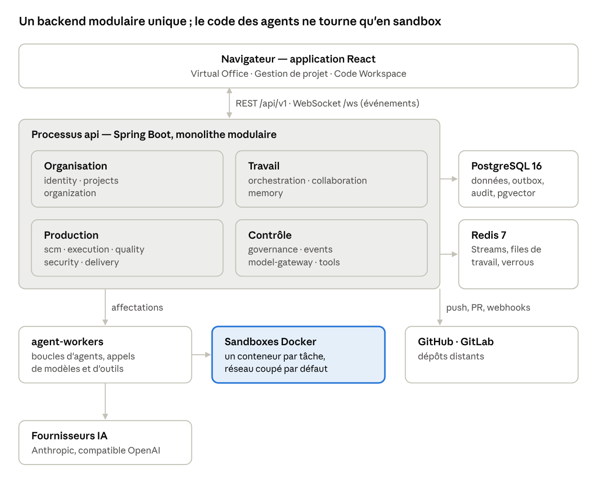
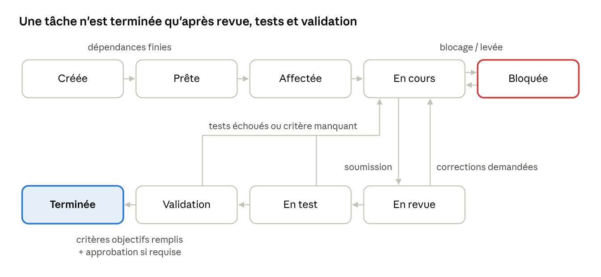
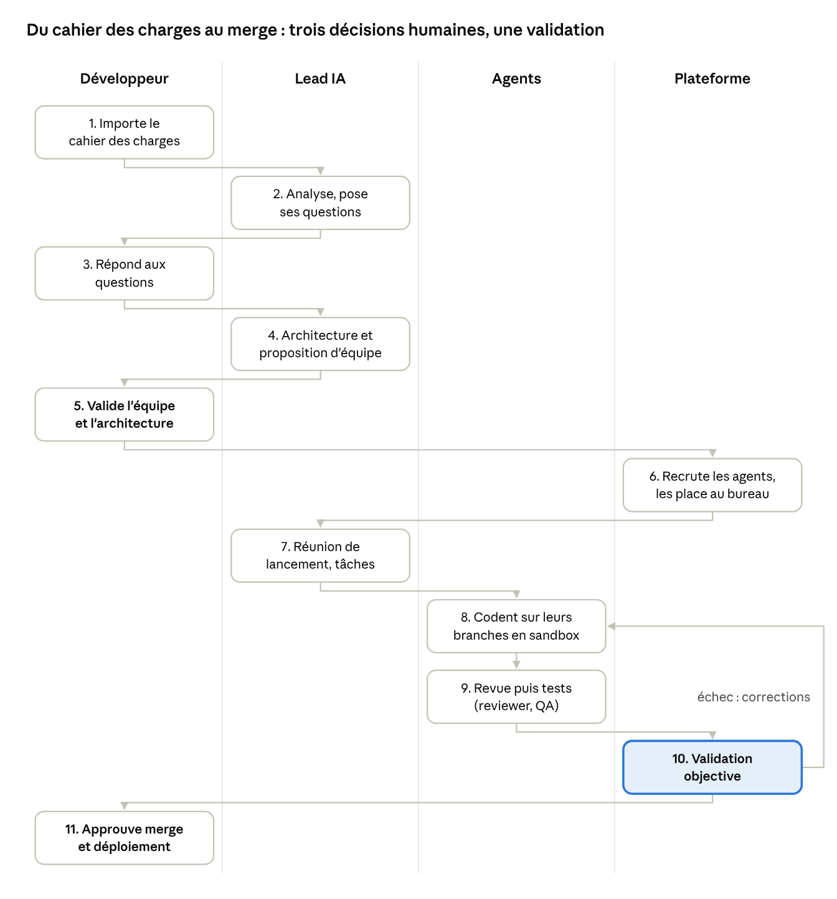
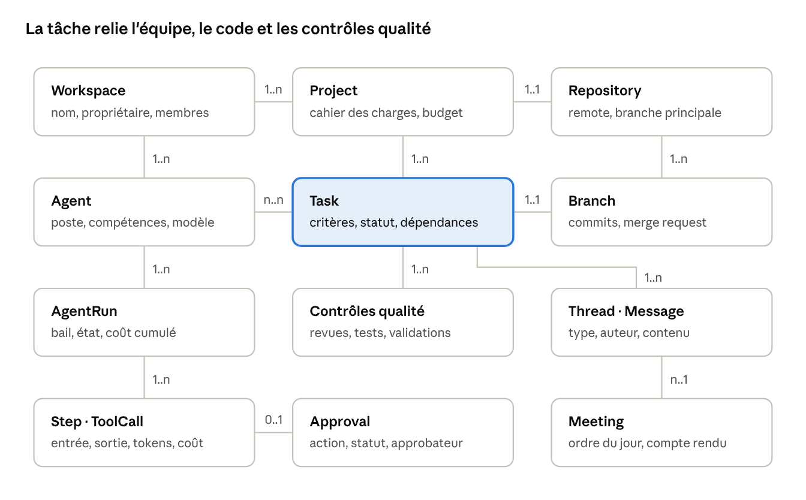
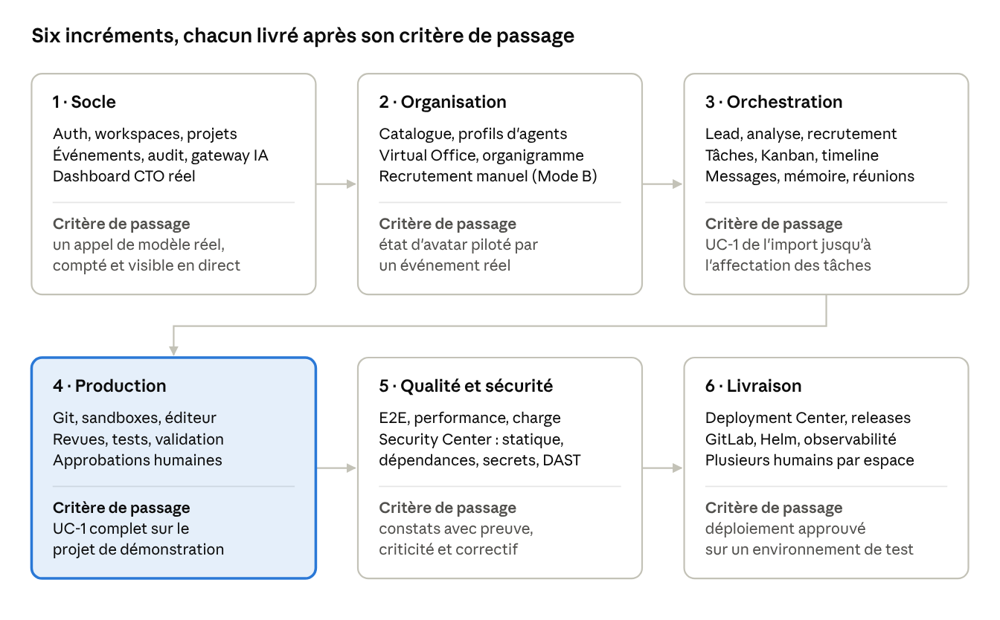

# AI Engineering Workspace — Architecture

8 novembre 2026 · Périmètre : produit complet, livré en six incréments.

## Vue d'ensemble

L'architecture comprend un backend Spring Boot modulaire, des workers qui exécutent les boucles d'agents, et des sandboxes Docker où tourne tout le code produit. PostgreSQL et Redis portent l'état et le flux d'événements qui alimente l'interface.



Les workers partagent PostgreSQL et Redis avec le processus api et utilisent les mêmes modules governance et tools : aucun chemin d'exécution ne contourne le contrôle des permissions.

## Composants

Le backend est un monolithe modulaire Spring Boot de 16 modules (D4). Chaque module possède ses tables et n'est appelé que par son API publique ou par événement ; Spring Modulith vérifie ces frontières à la compilation des tests.

Un même code produit trois types de processus :

- **api** : HTTP, WebSocket, orchestration, projections ; une ou plusieurs instances.
- **agent-worker** : exécute les boucles d'agents ; mis à l'échelle selon le nombre d'agents actifs.
- **sandbox** : un conteneur Docker éphémère par tâche, piloté par le module execution ; il ne contient aucun code de la plateforme.

| Module | Responsabilité | Données possédées |
| --- | --- | --- |
| identity | Comptes, sessions, workspaces, membres humains et rôles | users, workspaces, memberships |
| projects | Projets, cahiers des charges, documents techniques, environnements, variables de configuration | projects, documents, environments |
| organization | Catalogue de profils, agents, départements, postes, organigramme, propositions de recrutement | role_templates, agents, departments, positions, hiring_proposals |
| orchestration | Plans, graphe de tâches, ordonnancement, affectations, détection des blocages, relances, reprise | plans, tasks, task_dependencies, assignments, runs |
| agent-runtime | Boucle d'un agent : construction du contexte, appel du modèle, appels d'outils, production de livrables | agent_sessions, steps |
| model-gateway | Adaptateurs fournisseurs, routage par poste, comptage des tokens, coût, budgets | providers, model_bindings, usage_records, budgets |
| tools | Registre des outils, serveurs MCP, exécution des appels d'outils après contrôle de permission | tool_definitions, tool_calls |
| memory | Mémoire partagée du projet (décisions, contrats, glossaire), mémoire de chaque agent, recherche sémantique | memory_entries, embeddings |
| collaboration | Messages entre agents et humains, fils, demandes de revue ou de clarification, réunions et comptes rendus | threads, messages, meetings, minutes, action_items |
| scm | Dépôts, branches, commits, merges, détection des conflits, GitHub et GitLab | repositories, branches, commits, merge_requests |
| execution | Cycle de vie des conteneurs, commandes autorisées, journaux, ressources | sandboxes, command_runs, log_chunks |
| quality | Exécutions de tests, revues de code, moteur de validation, rapports qualité | test_runs, test_results, reviews, validations |
| security | Analyse statique, dépendances, secrets, tests dynamiques autorisés, constats avec preuve et criticité | scans, findings |
| delivery | Pipelines, versions, déploiements par environnement | releases, deployments |
| governance | Politiques de permissions, file d'approbations, quotas, journal d'audit, coffre de secrets | policies, approvals, quotas, audit_log, secrets |
| events | Journal d'événements, outbox, diffusion temps réel, projections (Virtual Office, dashboard, timeline) | events, outbox, read models |

Le frontend est une application React unique avec trois espaces (Virtual Office, gestion de projet, Code Workspace) qui partagent le même flux d'événements.

## Système multi-agents

Un agent n'est pas un prompt : c'est une entité persistante (profil, modèle, outils, permissions, mémoire) dont chaque pas d'exécution est enregistré, reprenable et visible. Le moteur est maison (D8) ; les outils suivent le protocole MCP.

### Boucle d'exécution d'un agent

1. Un agent-worker prend une affectation avec un bail (lease) renouvelé par heartbeat ; si le worker tombe, un autre reprend au dernier pas enregistré.
2. Le context builder assemble : instructions du poste, tâche et critères d'acceptation, extraits pertinents de la mémoire partagée, mémoire de l'agent, messages non lus, état de sa branche. Un budget de tokens par section borne la taille.
3. Le model-gateway appelle le modèle lié au poste et enregistre tokens et coût.
4. Le modèle répond par des appels d'outils typés ; chacun passe par governance (permission, quota, approbation) avant exécution.
5. Chaque pas (entrée, sortie, outil, durée, coût) est persisté et émis comme événement.
6. La boucle s'arrête sur : livrable soumis, blocage déclaré, attente d'une réponse, budget ou nombre de pas atteint, suspension par l'humain.

### Outils de base d'un agent

| Famille | Outils | Contrôle |
| --- | --- | --- |
| Code | lire, chercher, écrire, déplacer un fichier ; commit sur sa branche | Limité à sa branche et à son périmètre de fichiers |
| Exécution | lancer une commande dans son sandbox (build, tests, linters) | Liste blanche par poste, quotas CPU, mémoire et durée |
| Collaboration | envoyer un message, demander une clarification, déclarer une dépendance, demander une revue, proposer une réunion | Nombre de tours limité par fil |
| Travail | déclarer un blocage, soumettre un livrable, enregistrer une décision en mémoire partagée | Une soumission déclenche la validation, jamais la clôture |
| Management (Lead, managers) | créer ou découper des tâches, affecter, proposer un recrutement, convoquer une réunion, demander des corrections | Crée des propositions soumises aux politiques, pas des faits accomplis |
| Spécialisés | revue de code, exécution de suites de tests, scanners de sécurité, préparation de déploiement | Attribués par poste |

### Orchestrateur

- **Planification** : le plan est un graphe de tâches avec dépendances ; seules les tâches dont les dépendances sont terminées deviennent prêtes.
- **Affectation** : le Lead (Mode A) ou l'humain (Mode B) affecte ; l'ordonnanceur respecte la disponibilité, la limite de tâches simultanées par agent et le budget.
- **Surveillance** : un watchdog détecte l'absence de progrès (pas répétés, erreurs en boucle, délai dépassé), passe la tâche en bloqué et escalade au Lead puis à l'humain.
- **Reprise** : relance au dernier pas, réaffectation, ou découpage de la tâche ; les appels d'outils portent une clé d'idempotence.

### Cycle de vie d'une tâche



Seul le moteur de validation fait passer une tâche à Terminée. Il exige des tests exécutés et réussis, une revue acceptée, des critères d'acceptation cochés avec preuve et aucun constat critique ouvert.

### Communication et mémoire

- Les messages sont typés (question, réponse, recommandation, problème, dépendance, demande de revue) et rangés dans des fils liés à une tâche ou une réunion. Un agent qui attend une réponse passe en attente sans consommer de tokens.
- **Mémoire partagée** : décisions d'architecture, contrats d'API, conventions, glossaire, décisions de réunion. On n'y écrit que par l'outil dédié ; chaque entrée est versionnée et sourcée.
- **Mémoire individuelle** : notes de travail et résumés des sessions passées de l'agent.
- Recherche hybride (sémantique pgvector + texte + récence) ; le code lui-même reste dans Git, jamais copié en mémoire.

### Réunions

Une réunion est un workflow : l'organisateur fixe l'ordre du jour, chaque participant reçoit le contexte, puis contribue par tours successifs. Une synthèse produit le compte rendu. Les décisions vont en mémoire partagée, les actions deviennent des tâches, les désaccords sont conservés. L'humain peut intervenir à chaque tour.

### États visibles d'un agent

L'état affiché est calculé à partir de l'activité réelle, jamais posé à la main par l'interface.

| État affiché | Événement déclencheur |
| --- | --- |
| Disponible | Aucune affectation active |
| En réflexion | Appel de modèle en cours |
| En développement | Outil d'écriture de fichier ou de commit appelé |
| En test | Commande de test en cours dans le sandbox |
| En revue de code | Revue affectée et ouverte |
| En réunion | Participant d'une réunion ouverte |
| Bloqué | Blocage déclaré ou détecté par le watchdog |
| En attente de validation | Livrable soumis, validation ou approbation en cours |
| En pause | Suspendu par l'humain ou budget épuisé |
| Mission terminée | Tâche validée par le moteur de validation |

## Flux d'interaction

Dans UC-1, l'humain décide à trois moments (réponses, validation de l'équipe, approbation finale). Le Lead organise, les agents produisent, et la plateforme seule déclare un travail terminé.



En Mode B, le développeur remplace le Lead aux étapes 2, 4 et 7 ; le reste du parcours est identique.

### Du fait réel à l'animation

Chaque animation du Virtual Office suit ce chemin, sans raccourci :

1. Un module change un état (tâche, agent, réunion) et écrit l'événement dans l'outbox, dans la même transaction PostgreSQL.
2. Un relais publie l'événement dans un Redis Stream avec son numéro de séquence.
3. Les projections mettent à jour leurs vues (Virtual Office, dashboard, timeline, Kanban).
4. La passerelle WebSocket pousse l'événement aux clients abonnés au projet.
5. Le client met à jour son store, et PixiJS anime l'avatar : déplacement vers la salle de réunion, icône d'activité, bulle de blocage.

Au chargement, le client lit la projection complète puis rejoue les événements plus récents que son numéro de séquence.

## Modèle de données

La tâche est l'entité pivot : elle relie un ou plusieurs agents (via les affectations), une branche Git, ses contrôles qualité et ses fils de discussion. Toutes les tables portent `workspace_id` pour l'isolation et des identifiants ULID.



| Entité transverse | Rattachée à | Rôle |
| --- | --- | --- |
| RoleTemplate | Catalogue | Profil type : poste, compétences, instructions, outils et modèle par défaut |
| Department, Position | Workspace | Organigramme et rattachement hiérarchique des agents |
| HiringProposal | Project | Recrutements proposés par le Lead, avec justification et décision humaine |
| ModelBinding, Budget, UsageRecord | Agent, Project | Modèle utilisé par poste, limites et consommation réelle |
| Policy | Workspace, Project | Règles allow, deny ou require_approval par poste et par outil |
| MemoryEntry | Project ou Agent | Mémoire partagée ou individuelle, versionnée, avec embedding |
| Deliverable | Task | Livrable soumis : fichiers, commit, rapport |
| TaskDependency | Task | Graphe des dépendances entre tâches |
| Decision, ActionItem | Meeting | Décisions et actions issues des réunions ; une action devient une tâche |
| SecurityScan, Finding | Project, Branch | Constats avec preuve, criticité et recommandation |
| Release, Deployment | Project | Versions et déploiements par environnement |
| Secret | Project | Valeur chiffrée, jamais renvoyée par l'API |
| Event, AuditLog | Workspace | Journal d'événements (séquencé) et journal d'audit (append-only, chaîné) |

## Contrats API

Trois contrats : une API REST versionnée pour les commandes et les lectures, un canal WebSocket pour les événements temps réel, et le protocole MCP pour les outils des agents. Le contrat REST est décrit en OpenAPI 3.1 et le client TypeScript du frontend en est généré.

### REST (`/api/v1`)

| Ressource | Opérations principales |
| --- | --- |
| `/workspaces`, `/projects` | CRUD, import du cahier des charges, documents, environnements |
| `/projects/{id}/lead/briefings` | Lancer l'analyse par le Lead, répondre à ses questions |
| `/role-templates`, `/agents` | Catalogue extensible, recrutement, profil, suspension, remplacement, liaison modèle et outils |
| `/projects/{id}/hiring-proposals` | Lire, accepter, modifier, refuser une proposition du Lead |
| `/projects/{id}/tasks` | CRUD, affectation, dépendances, historique, livrables |
| `/threads`, `/messages` | Converser avec un agent, lire les échanges entre agents |
| `/meetings` | Convoquer, participer (envoyer une intervention), lire le compte rendu |
| `/projects/{id}/repo` | Arborescence, fichier, diff par agent ou par tâche, commits, branches, merge requests |
| `/test-runs`, `/reviews`, `/scans` | Lancer, lire résultats et constats |
| `/approvals` | Lister les actions en attente, approuver ou refuser avec motif |
| `/releases`, `/deployments` | Préparer, lancer après approbation, suivre |
| `/dashboard`, `/timeline`, `/usage` | Indicateurs, activité, consommation et coût |

Toute commande retourne `202 Accepted` avec l'identifiant de l'opération quand elle déclenche un travail d'agent ; le résultat arrive par événement.

### Temps réel

Un WebSocket par session (`/ws`, protocole STOMP), avec abonnement par sujet : `project.{id}`, `agent.{id}`, `task.{id}`, `meeting.{id}`, `sandbox.{id}.logs`. Chaque message porte le numéro de séquence de l'événement ; après une coupure, le client reprend depuis le dernier numéro reçu.

### Enveloppe d'événement

```json
{
  "id": "01JC9Z...",
  "seq": 18452,
  "type": "task.status_changed",
  "occurredAt": "2026-11-08T10:42:13Z",
  "workspaceId": "...",
  "projectId": "...",
  "actor": { "kind": "agent", "id": "..." },
  "subject": { "kind": "task", "id": "..." },
  "causationId": "...",
  "correlationId": "...",
  "payload": { "from": "in_progress", "to": "in_review" }
}
```

### Familles d'événements

| Famille | Exemples |
| --- | --- |
| agent | `agent.hired`, `agent.state_changed`, `agent.suspended`, `agent.step_completed` |
| task | `task.created`, `task.assigned`, `task.status_changed`, `task.blocked`, `task.deliverable_submitted` |
| collaboration | `message.sent`, `review.requested`, `meeting.started`, `meeting.turn`, `meeting.minutes_published` |
| code | `file.changed`, `commit.created`, `merge.conflict_detected`, `merge.completed` |
| execution | `sandbox.started`, `command.started`, `command.finished`, `test_run.finished` |
| qualité et sécurité | `review.completed`, `validation.passed`, `validation.failed`, `scan.finding_detected` |
| gouvernance | `approval.requested`, `approval.granted`, `approval.denied`, `budget.threshold_reached` |
| modèles | `model.call_completed` (tokens, coût, latence) |

### Outils (MCP)

Les outils internes (fichiers, commandes, collaboration, management) sont exposés aux agents comme un serveur MCP interne. Des serveurs MCP externes peuvent être ajoutés par projet ; leurs outils passent par le même contrôle de permissions. Le model-gateway traduit le format MCP vers le format d'appel d'outils de chaque fournisseur.

## Choix technologiques

La stack reprend celle du brief, avec deux ajouts justifiés : pgvector pour la mémoire sémantique et PixiJS pour le Virtual Office. Les versions exactes seront figées lors de l'initialisation du dépôt.

| Couche | Choix | Justification |
| --- | --- | --- |
| Backend | Java 21, Spring Boot 3, Spring Modulith | Threads virtuels adaptés aux nombreux appels de modèles en attente ; frontières de modules vérifiées |
| Persistance | PostgreSQL 16, Flyway, jOOQ ou JPA selon le module | Données relationnelles, JSONB pour les payloads d'événements, transactions avec l'outbox |
| Mémoire sémantique | pgvector dans le même PostgreSQL | Pas de base supplémentaire à opérer |
| Coordination et messagerie | Redis 7 : Streams (événements, files de travail), verrous, cache (D5) | Suffisant en auto-hébergé ; interface prête pour Kafka |
| Appels de modèles | Adaptateurs maison derrière une interface commune ; SDK Anthropic Java, client compatible OpenAI | Contrôle total du streaming, des outils, du comptage et des budgets |
| Outils | Model Context Protocol (SDK Java MCP) | Standard ouvert, outils externes ajoutables sans code |
| Sandbox | Docker Engine API (docker-java), images par langage, gVisor en option | Isolation forte, réseau coupé par défaut |
| Git | JGit pour les opérations locales, API GitHub et GitLab | Opérations Git sans dépendre d'un binaire dans le processus api |
| Analyse de sécurité | Semgrep, Trivy et OSV, Gitleaks, OWASP ZAP | Outils reconnus, exécutés dans le sandbox |
| Frontend | React 18, TypeScript, Vite, TanStack Query, Zustand, Tailwind | Écosystème riche, client généré depuis OpenAPI (D6) |
| Virtual Office | PixiJS (WebGL 2D isométrique) (D7) | Rendu fluide de dizaines d'agents animés |
| Code Workspace | Monaco Editor, vue de diff Monaco | Expérience proche de VS Code |
| Temps réel | WebSocket STOMP (Spring) | Abonnements par sujet, reprise par numéro de séquence |
| Secrets | Chiffrement enveloppe (AES-GCM) avec clé maître locale ; HashiCorp Vault en option | Fonctionne en auto-hébergé sans dépendance obligatoire |
| Observabilité | OpenTelemetry, Micrometer, Prometheus, Grafana | Traces d'un appel d'agent de bout en bout |
| Distribution | Docker Compose (D1) ; chart Helm ensuite | Installation en une commande |
| Tests | JUnit 5, Testcontainers, ArchUnit ; Vitest, Playwright | Tests réels contre PostgreSQL, Redis et Docker |

L'authentification utilise Spring Security avec sessions et mots de passe hachés (Argon2), plus OIDC optionnel (GitHub, Google, Keycloak).

## Stratégie de sécurité

La règle de base : le modèle ne décide jamais de ce qu'il a le droit de faire. Chaque appel d'outil est vérifié côté serveur par le module governance avant exécution, et tout ce qui vient de l'extérieur (code, dépendances, documents, pages web) est traité comme des données.

| Mesure | Mise en œuvre |
| --- | --- |
| Permissions granulaires | Politique = (poste, outil, ressource, condition) ; décision allow, deny ou require_approval ; politiques par défaut par poste, surchargées par projet |
| Isolation | Un conteneur par tâche, utilisateur non root, système de fichiers limité à la copie de travail, réseau coupé sauf registres de paquets autorisés, limites CPU, mémoire, disque et durée ; le processus api n'exécute jamais de code d'agent |
| Secrets | Chiffrés au repos, injectés comme variables d'environnement du sandbox au moment de l'exécution, jamais placés dans le contexte d'un modèle, masqués dans les logs ; Gitleaks avant chaque commit |
| Validation humaine | Suppression de fichiers protégés, configurations sensibles, accès production, publication, déploiement, suppression de branche, données sensibles : l'action est suspendue dans la file d'approbations jusqu'à décision |
| Protection de Git | Agents limités à leurs branches ; branche principale protégée ; merge seulement après revue et validation ; pas de force push |
| Quotas et budgets | Par workspace, projet et agent : tokens, coût, pas, durée de sandbox ; alerte à 80 %, pause à 100 % |
| Traçabilité | Journal d'audit append-only (qui, quoi, sur quoi, décision de politique, approbateur), chaîné par hachage ; chaque commit d'agent signé avec l'identité de l'agent |
| Injection de prompt | Contenus externes balisés comme données dans le contexte, outils sensibles toujours soumis à politique, pas d'outil qui change les permissions accessible aux agents |
| Comptes humains | Argon2, sessions sécurisées, protection CSRF, OIDC optionnel, rôles owner, admin, member, viewer |
| Plateforme | Images signées et scannées, dépendances scannées en CI, en-têtes de sécurité HTTP, chiffrement TLS |

## Plan de livraison du produit complet

Le périmètre est le produit complet : il n'y a pas de coupe MVP. On le construit en six incréments, dans l'ordre, car le brief exige que chaque phase soit testée avant la suivante.



L'incrément 4 est la porte la plus importante : c'est le premier moment où la promesse entière (des agents qui livrent du vrai code validé) est démontrée. Aucune durée n'est fixée ici ; chaque incrément se termine par un rapport : fait, reste à faire, blocages.

L'architecture ci-dessus couvre dès maintenant les six incréments : aucun module ne sera ajouté en cours de route, seuls leurs contenus s'étoffent.
